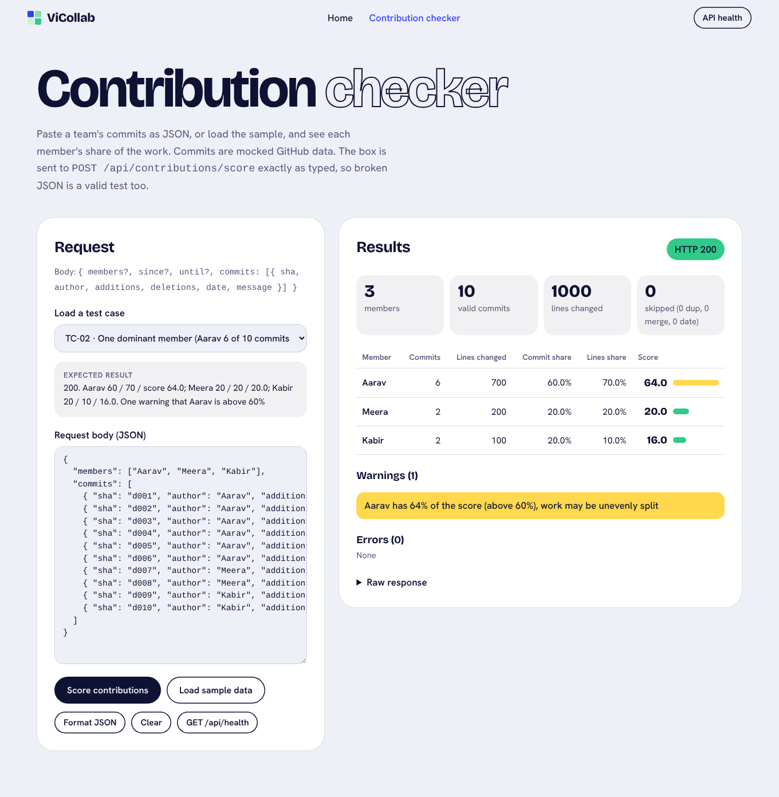
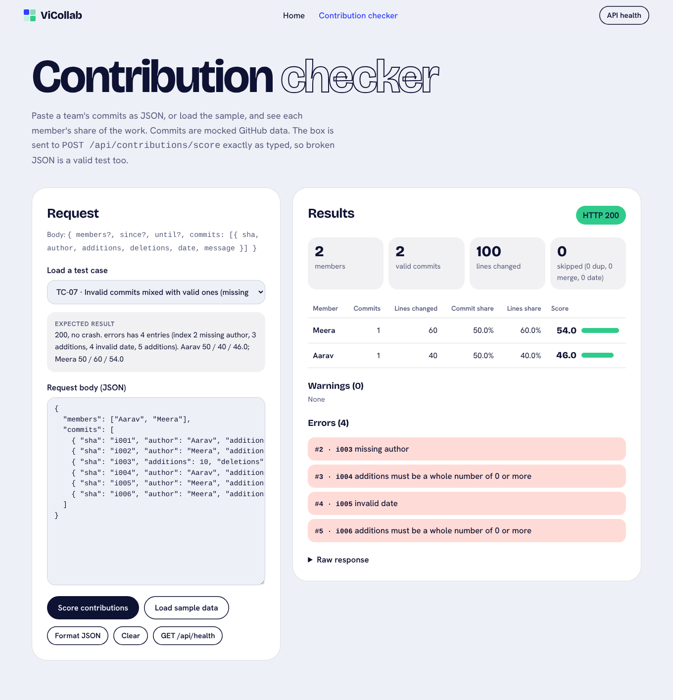
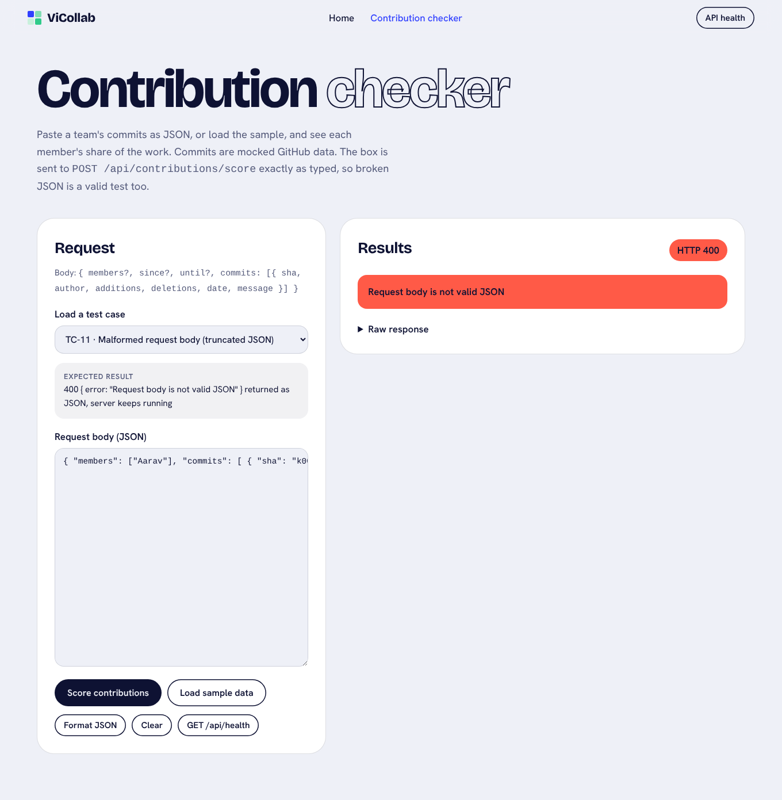

# Test Report: ViCollab Contribution Scoring Module

**Course:** BCSE301P Software Engineering Lab, Assessment 8\
**Project:** ViCollab, a GitHub-verified collaboration platform for student project teams\
**Team 20:** Mrinal Gupta, Vaaman Bansal\
**Module under test:** Contribution Scoring (part of *GitHub Integration & Contribution Tracking*)\
**Test dates:** 19 October 2026\
**Result:** 14/14 test cases pass. 3 defects found during testing, all fixed and re-tested.

---

## 1. Module description

Contribution Scoring takes the list of commits for a team and works out each member's share of the work. In the full product the commits would come from the GitHub API after OAuth. For this assessment the commit data is **mocked** and sent in the request body.

**Input** (`POST /api/contributions/score`, JSON):

```jsonc
{
  "members": ["Aarav", "Meera"],        // optional: team list, so members with 0 commits can be flagged
  "since": "2026-03-01",                // optional, inclusive
  "until": "2026-03-15",                // optional, inclusive (a date-only value covers the whole day)
  "commits": [ { "sha": "a1f001", "author": "Aarav", "additions": 40, "deletions": 10,
                 "date": "2026-03-02T10:00:00Z", "message": "feat: github oauth callback" } ]
}
```

**Processing rules**

| Rule | Behaviour |
|---|---|
| Validation | A commit with a missing sha or author, `additions`/`deletions` that are not whole numbers ≥ 0, or a date that is not a real ISO 8601 date goes into `errors` as `{ index, sha, reason }`. The remaining commits are still scored. |
| Duplicates | A repeated `sha` is counted once (`skipped.duplicates`). |
| Merge commits | A message starting with the word `Merge` is dropped (`skipped.merges`). |
| Date filter | Commits outside `since`…`until` are dropped (`skipped.outsideDateRange`). |
| Per member | `commits`, `linesChanged` = additions + deletions, `commitShare` %, `linesShare` %, `score = 0.6 × commitShare + 0.4 × linesShare`, all rounded to 1 decimal. |
| Warnings | A member whose score is above 60 when the team has 2 or more members; any member with 0 valid commits; no valid commits at all. |
| Bad request | Empty or missing `commits`, a body that is not JSON or not an object, or bad `since`/`until` returns HTTP 400 `{ error }`. |

**Files**

| File | Purpose |
|---|---|
| `src/scoring.js` | `scoreContributions()`: a pure function with no I/O |
| `src/app.js` | Express app: `POST /api/contributions/score`, `GET /api/health`, JSON error handler, static pages |
| `src/server.js` | Starts the server on port 3000 |
| `public/contribution-checker.html` | UI page for manual testing, in the home page's visual style |
| `public/ViCollab_Home_Page.html` | Existing home page. The only change is a *Contribution checker* nav link. |
| `test-cases/TC-xx.json` | The inputs for every test case, shared by the UI, Postman and Jest |
| `tests/scoring.test.js`, `tests/api.test.js` | Jest unit tests and Supertest integration tests |
| `postman/…postman_collection.json` | Postman collection: 14 requests with `pm.test` assertions |

**Design decisions and assumptions** (the brief didn't specify these, so we chose and tested them):

1. Author names are matched ignoring case and surrounding spaces, because GitHub logins are case-insensitive.
2. `"Merge…"` is matched as a whole word: `Merge pull request…` and `Merge branch…` are dropped, but `Mergesort for the task list` is a normal commit.
3. A date-only `until` (e.g. `2026-03-15`) includes the whole of that day.
4. A date with a time must carry a timezone (`Z` or `+05:30`), as GitHub dates do. Otherwise the result would depend on the server's timezone.
5. If the team changed 0 lines in total, `linesShare` is 0 for everyone (no division by zero), so the score comes from the commit part only.
6. Shares are rounded independently, so they can add up to 99.9 or 100.1.

## 2. Tools used

| Purpose | Tool | Version |
|---|---|---|
| Runtime | Node.js | 22.22.0 |
| Web framework | Express | 5.3.0 |
| Unit test runner and coverage | Jest (built-in Istanbul coverage) | 30.5.2 |
| HTTP integration testing | Supertest | 7.3.1 |
| Manual API testing | Postman (collection v2.1) | n/a |
| Running the Postman collection from the command line | Newman | 6.2.3 |
| Scripted run of the UI steps and screenshots | Playwright with Chromium | 1.56.1 |
| Ad-hoc probing | curl | n/a |

## 3. Test environment

| Item | Value |
|---|---|
| OS | Ubuntu 24.04.5 LTS (Linux 6.18 kernel), cloud dev container |
| Server | `npm start` on `http://localhost:3000` |
| Browser | Chromium (headless, via Playwright). Viewports: 1360×1000 desktop and 390×900 phone, light and dark mode |
| Data | Mocked commits for the sample team from the home page (Aarav, Meera, Kabir, Isha). No database and no real GitHub calls. |

## 4. Test scenarios

| # | Scenario | Type | Test cases |
|---|---|---|---|
| S1 | Correct scoring of a normal team | Normal | TC-01, TC-02 |
| S2 | Team-size edges: one member, a member with no commits | Boundary | TC-03, TC-04 |
| S3 | Commits that must be skipped: duplicates, merges | Data cleaning | TC-05, TC-06 |
| S4 | Bad commit data reported without crashing | Invalid | TC-07 |
| S5 | Date range filter | Normal / boundary | TC-08 |
| S6 | Bad requests: empty list, missing field, malformed JSON | Invalid | TC-09, TC-10, TC-11 |
| S7 | Numeric edges: the exact 60% limit, 0 lines changed | Boundary | TC-12, TC-13 |
| S8 | Service availability | Normal | TC-14 |

## 5. Test cases and results

Each input is in `test-cases/<ID>.json` (TC-11 is `TC-11.txt`), and the full text of each one is printed in `docs/MANUAL_TESTING.md`. The *Actual* column comes from the final run against the fixed code. The same values came back from the API (curl and Newman) and from the checker page (Playwright walkthrough). Scores are shown as commitShare / linesShare / score.

| ID | Scenario | Input | Expected output | Actual output | Status |
|---|---|---|---|---|---|
| TC-01 | Balanced team | 3 members, 2 commits and 100 lines each | 200. Each member 2 commits, 100 lines, 33.3 / 33.3 / 33.3. No warnings or errors. | 200. Aarav, Kabir, Meera: 2c, 100L, 33.3 / 33.3 / 33.3. warnings [], errors [] | **Pass** |
| TC-02 | One dominant member | Aarav 6 of 10 commits, 700 of 1000 lines; Meera 2 / 200; Kabir 2 / 100 | 200. Aarav 60 / 70 / 64.0, Meera 20 / 20 / 20.0, Kabir 20 / 10 / 16.0. One warning about Aarav. | 200. Aarav 60 / 70 / 64, Meera 20 / 20 / 20, Kabir 20 / 10 / 16. Warning: "Aarav has 64% of the score (above 60%), work may be unevenly split" | **Pass** |
| TC-03 | Single-member team | members [Isha], 3 commits, 100 lines | 200. Isha 3c, 100L, 100 / 100 / 100. No dominance warning (team of 1). | 200. Isha 3c, 100L, 100 / 100 / 100. warnings [] | **Pass** |
| TC-04 | Member with zero commits | members [Aarav, Meera, Kabir, Isha]; Isha has no commits | 200. Aarav 50 / 60 / 54.0, Meera and Kabir 25 / 20 / 23.0, Isha 0 / 0 / 0. Warning "Isha has 0 valid commits". | 200. Aarav 50 / 60 / 54, Kabir 25 / 20 / 23, Meera 25 / 20 / 23, Isha 0c 0 / 0 / 0. warnings ["Isha has 0 valid commits"] | **Pass** |
| TC-05 | Duplicate shas | sha `g001` sent 3 times, plus 1 commit by Meera | 200. g001 counted once. Both members 1c, 50L, score 50.0. skipped.duplicates = 2 | 200. Aarav 1c / 50L / 50, Meera 1c / 50L / 50. skipped {duplicates: 2} | **Pass** |
| TC-06 | Merge commits | 2 normal commits, `Merge pull request #7…`, `Merge branch 'main'…`, `Mergesort for the task list` | 200. skipped.merges = 2. Aarav 33.3 / 30 / 32.0, Meera 33.3 / 30 / 32.0, Kabir 33.3 / 40 / 36.0 | 200. skipped {merges: 2}. Kabir 1c / 40L / 33.3 / 40 / 36, Aarav 33.3 / 30 / 32, Meera 33.3 / 30 / 32 | **Pass** |
| TC-07 | Invalid commit data | 2 valid commits, plus: missing author (index 2), additions −5 (3), date "next tuesday" (4), additions "12" as text (5) | 200, no crash. 4 errors at indexes 2, 3, 4, 5. Aarav 50 / 40 / 46.0, Meera 50 / 60 / 54.0 | 200. errors: 2 missing author, 3 additions must be a whole number of 0 or more, 4 invalid date, 5 additions must be a whole number of 0 or more. Meera 54, Aarav 46 | **Pass** |
| TC-08 | Date filter | since 2026-03-01, until 2026-03-15. Commits on 25 Feb, 2 Mar, 15 Mar 18:30Z, 20 Mar | 200. skipped.outsideDateRange = 2. The 15 Mar 18:30 commit is kept. Aarav 50.0, Meera 50.0, Kabir 0 with a warning. | 200. outsideDateRange 2. Aarav 1c / 50, Meera 1c / 50, Kabir 0c / 0. warnings ["Kabir has 0 valid commits"] | **Pass** |
| TC-09 | Empty commit list | `{"members":[…],"commits":[]}` | 400 `{error: "\"commits\" must be a non-empty array of commit objects"}` | 400 `{"error":"\"commits\" must be a non-empty array of commit objects"}` | **Pass** |
| TC-10 | Missing commits field | `{"members":["Aarav","Meera"]}` | 400 with the same message | 400 `{"error":"\"commits\" must be a non-empty array of commit objects"}` | **Pass** |
| TC-11 | Malformed request body | Truncated JSON: `{ "members": ["Aarav"], "commits": [ { "sha": "k001", …` | 400 JSON `{error: "Request body is not valid JSON"}` (not an HTML error page). Server keeps running. | 400 `{"error":"Request body is not valid JSON"}`, content-type application/json. A health check straight afterwards returned 200. | **Pass** |
| TC-12 | Exactly at the 60% limit | Aarav 3 of 5 commits, 60 of 100 lines | 200. Aarav 60 / 60 / 60.0, Meera 40.0. No warning (the rule is *above* 60). | 200. Aarav 60 / 60 / 60, Meera 40 / 40 / 40. warnings [] | **Pass** |
| TC-13 | Zero lines changed | 4 empty commits (0 additions, 0 deletions) | 200, no NaN. Both members 2c, 0L, 50 / 0 / 30.0 | 200. Aarav and Meera 2c, 0L, 50 / 0 / 30. No NaN or null in the body. | **Pass** |
| TC-14 | Health check | `GET /api/health` | 200 `{status: "ok", service: "contribution-scoring", time}` | 200 `{"status":"ok","service":"contribution-scoring","time":"2026-10-19T15:44:40.646Z"}` | **Pass** |

**Result: 14 of 14 test cases passed** (after fixing DEF-01 to DEF-03, see section 8).

## 6. Manual testing

The full step-by-step procedure, with the exact text to paste for every case, is in **`docs/MANUAL_TESTING.md`**. In short:

**Through the UI (`contribution-checker.html`)**
1. Run `npm start` and open `http://localhost:3000/`. Click **Contribution checker** in the nav.
2. Paste the case input into **Request body (JSON)**, or pick it from **Load a test case**, which also shows the expected result.
3. Click **Score contributions** (TC-14: **GET /api/health**).
4. Read the status pill, stat tiles, results table, Warnings and Errors lists, and Raw response, and compare with the Expected column.

**Through Postman**
1. Import `postman/ViCollab_Contribution_Scoring.postman_collection.json` (`baseUrl` = `http://localhost:3000`).
2. Open each request TC-01 to TC-14, click **Send**, and check the status code, the Body and the **Test Results** tab.
3. Or click **Run collection** to run all 14 at once.

**How the manual runs were recorded for this report.** The UI steps were carried out in Chromium by a Playwright script (`scripts/ui-walkthrough.js`). It does exactly what the procedure says: open the home page, click the nav link, load each case, click the button, then read the table, warnings and errors and take a screenshot. The Postman collection was run with **Newman**, Postman's command-line runner, which executes the same requests and `pm.test` checks as the Postman app. *Before submitting, repeat the UI and Postman steps by hand and add your own screenshots if your evaluator wants evidence of a hands-on run.*

**UI walkthrough results** (`docs/test-output/ui-walkthrough.txt`, screenshots in `docs/screenshots/`)

| Check | Result |
|---|---|
| Home page nav link → `contribution-checker.html` | Works |
| *Load sample data* + *Score* | HTTP 200. Meera 33.7, Aarav 29.6, Isha 23.8, Kabir 12.9 (1 merge and 1 duplicate skipped) |
| TC-01 to TC-14 in the UI | All 14 matched the expected results (same values as the API table above) |
| Author name containing HTML (``) | Shown as plain text, script not run |
| Phone width (390 px) | No horizontal page scroll. The results table scrolls inside its own card. |
| Dark mode | Readable, with tokens taken from the home page |
| Browser console | Only the browser's own "Failed to load resource: 400" lines for TC-09, 10 and 11, which are expected |

**Postman (Newman) run, final code** (`docs/test-output/newman-postman-run.txt`)

```
┌─────────────────────────┬──────────────────┬─────────────────┐
│                         │         executed │          failed │
├─────────────────────────┼──────────────────┼─────────────────┤
│                requests │               14 │               0 │
│            test-scripts │               14 │               0 │
│              assertions │               40 │               0 │
├─────────────────────────┴──────────────────┴─────────────────┤
│ average response time: 9ms [min: 3ms, max: 61ms, s.d.: 14ms] │
└──────────────────────────────────────────────────────────────┘
```

## 7. Automated testing

### 7.1 Procedure
1. `npm install` installs Express, Jest, Supertest and Newman.
2. `npm test` runs `jest --coverage`. Jest finds `tests/*.test.js`:
   * `tests/scoring.test.js` (**unit**, 29 tests) calls `scoreContributions()` directly with the `test-cases/` files and some hand-made commits.
   * `tests/api.test.js` (**integration**, 22 tests) uses Supertest to send real HTTP requests to the Express app in memory, with no port needed, and checks status codes, headers and JSON bodies.
3. Jest prints PASS/FAIL for each test and an Istanbul coverage table for `src/app.js` and `src/scoring.js`. `src/server.js` is only `app.listen()`, so it is left out of coverage.
4. Optional: with `npm start` running, `npm run test:postman` runs the Postman collection through Newman.

Every test name starts with the TC ID it covers, and tests added for a defect are tagged `(DEF-0x)`.

### 7.2 Traceability: test cases to automated tests

| TC | Unit tests (`scoring.test.js`) | Integration tests (`api.test.js`) |
|---|---|---|
| TC-01 | every member gets an equal third; input array is not changed | balanced team returns 200 with equal scores |
| TC-02 | shares and scores use 0.6 / 0.4 weights; warns that Aarav is above 60%; sorted by score | dominant member returns a warning |
| TC-03 | single member gets 100 and no dominance warning | single member scores 100 |
| TC-04 | listed member with no commits shows zeros and a warning; name matching ignores case and spaces | zero-commit member is listed with a warning |
| TC-05 | a repeated sha is only counted once | duplicates are skipped |
| TC-06 | "Merge…" dropped, "Mergesort" kept; a commit with no message is counted | merge commits are skipped |
| TC-07 | bad commits go to errors and valid ones are scored; other bad entries reported, not thrown; all invalid gives an empty result and a warning; vague or impossible dates rejected (DEF-01); real ISO forms accepted (DEF-01) | invalid commits come back in errors with status 200 |
| TC-08 | since/until filter, until day inclusive; only since or only until; until with a time; bad filter dates rejected | date filter is applied; invalid since returns 400 |
| TC-09 | empty list throws a clear input error | empty list returns 400 with a clear message |
| TC-10 | missing commits or no argument throws; members must be a list of names | missing commits returns 400; no body returns 400; top-level array returns 400 |
| TC-11 | n/a (handled in the HTTP layer) | wrong Content-Type explains the header (DEF-03); body over 1 MB returns 413 JSON; malformed JSON returns 400 JSON and the server keeps working; crash inside scoring returns a JSON 500 with no stack trace |
| TC-12 | exactly 60.0 gives no warning; exactly 60.05 rounds to 60.1 and warns (DEF-02); halves round up, 21.25 → 21.3 (DEF-02); rounding matches exact fraction maths on a 56,760-case grid (DEF-02); just above 60 warns | exactly 60% gives no warning |
| TC-13 | only empty commits: no NaN, linesShare 0 | zero lines changed gives numbers, not NaN or null |
| TC-14 | n/a | health returns ok; unknown API route returns JSON 404; home page and checker page are served and the home page links to the checker |

### 7.3 Final Jest output (`npx jest --coverage`, after fixes)

Full log: `docs/test-output/jest-after-fix.txt`.

```
PASS tests/api.test.js
  POST /api/contributions/score
    ✓ TC-01 balanced team returns 200 with equal scores (75 ms)
    ✓ TC-02 dominant member returns a warning (12 ms)
    ✓ TC-03 single member scores 100 (8 ms)
    ✓ TC-04 zero-commit member is listed with a warning (5 ms)
    ✓ TC-05 duplicates are skipped (5 ms)
    ✓ TC-06 merge commits are skipped (6 ms)
    ✓ TC-07 invalid commits come back in errors with status 200 (4 ms)
    ✓ TC-08 date filter is applied (4 ms)
    ✓ TC-08 invalid since returns 400 (6 ms)
    ✓ TC-09 empty commit list returns 400 with a clear message (4 ms)
    ✓ TC-10 missing commits returns 400 (4 ms)
    ✓ TC-10 no body at all returns 400 (3 ms)
    ✓ TC-10 a top-level array instead of an object returns 400 (3 ms)
    ✓ TC-11 JSON sent with the wrong Content-Type explains the header (DEF-03) (3 ms)
    ✓ TC-11 body over 1 MB returns 413 JSON (66 ms)
    ✓ TC-11 malformed JSON returns a 400 JSON error and the server keeps working (14 ms)
    ✓ TC-12 exactly 60% gives no warning (4 ms)
    ✓ TC-13 zero lines changed gives numbers, not NaN/null (7 ms)
  other routes
    ✓ TC-14 GET /api/health returns ok (3 ms)
    ✓ TC-14 unknown API route returns JSON 404 (3 ms)
    ✓ TC-14 home page and checker page are served, home links to the checker (12 ms)
  unexpected errors
    ✓ TC-11 a crash inside scoring returns a JSON 500 without the stack trace (41 ms)

PASS tests/scoring.test.js (5.088 s)
  TC-01 balanced team
    ✓ TC-01 every member gets an equal third (20 ms)
  TC-02 one dominant member
    ✓ TC-02 shares and scores use 0.6 / 0.4 weights (2 ms)
    ✓ TC-02 warns that Aarav is above 60% (1 ms)
    ✓ TC-02 members are sorted by score, highest first (2 ms)
  TC-03 single-member team
    ✓ TC-03 single member gets 100 and no dominance warning (1 ms)
  TC-04 member with zero commits
    ✓ TC-04 listed member with no commits is shown with zeros and a warning (2 ms)
    ✓ TC-04 author name matching ignores case and spaces (no false zero-commit warning) (1 ms)
  TC-05 duplicate shas
    ✓ TC-05 a repeated sha is only counted once (1 ms)
  TC-06 merge commits
    ✓ TC-06 messages starting with "Merge" are dropped, "Mergesort" is kept (2 ms)
  TC-06 merge commits (message is optional)
    ✓ TC-06 a commit with no message is counted normally (1 ms)
  TC-07 invalid commit data
    ✓ TC-07 bad commits go to errors and the valid ones are still scored (1 ms)
    ✓ TC-07 other kinds of bad entries are reported, not thrown
    ✓ TC-07 when every commit is invalid the result is empty with a warning (1 ms)
    ✓ TC-07 vague or impossible date strings are reported as invalid (DEF-01) (1 ms)
    ✓ TC-07 real ISO dates in different forms are still accepted (DEF-01)
  TC-08 date filter
    ✓ TC-08 since/until keep only commits in range, until day is inclusive (2 ms)
    ✓ TC-08 only since, or only until, also works (1 ms)
    ✓ TC-08 an until value with a time is used as given (1 ms)
    ✓ TC-08 bad filter dates are rejected (25 ms)
  TC-09 / TC-10 empty or missing commit list
    ✓ TC-09 empty commit list throws a clear input error (2 ms)
    ✓ TC-10 missing commits (or no argument at all) throws the same error (6 ms)
    ✓ TC-10 members must be a list of names (2 ms)
  TC-12 dominance boundary
    ✓ TC-12 a score of exactly 60.0 does not trigger the warning (1 ms)
    ✓ TC-12 a score of exactly 60.05 rounds to 60.1 and is warned about (DEF-02) (1 ms)
    ✓ TC-12 halves round up, e.g. 21.25 -> 21.3 (DEF-02) (1 ms)
    ✓ TC-12 rounding matches exact fraction maths on a grid of team sizes (DEF-02) (4842 ms)
    ✓ TC-12 just above 60 does trigger it (1 ms)
  TC-13 zero lines changed
    ✓ TC-13 only empty commits: no NaN, linesShare is 0 (1 ms)
  general
    ✓ TC-01 the input array is not changed (1 ms)

------------|---------|----------|---------|---------|-------------------
File        | % Stmts | % Branch | % Funcs | % Lines | Uncovered Line #s 
------------|---------|----------|---------|---------|-------------------
All files   |     100 |      100 |     100 |     100 |                   
 app.js     |     100 |      100 |     100 |     100 |                   
 scoring.js |     100 |      100 |     100 |     100 |                   
------------|---------|----------|---------|---------|-------------------
Test Suites: 2 passed, 2 total
Tests:       51 passed, 51 total
Snapshots:   0 total
Time:        5.592 s
Ran all test suites.
```

> Note: Jest 30 shortens its output to a summary when it detects it is running inside an AI coding agent. This log was captured with those environment variables unset (`env -u CLAUDECODE -u AI_AGENT npx jest --coverage --verbose`), so it matches what you'll see in a normal terminal. The test results are the same either way.

### 7.4 Coverage

| File | Statements | Branches | Functions | Lines |
|---|---|---|---|---|
| `src/app.js` | 100% | 100% | 100% | 100% |
| `src/scoring.js` | 100% | 100% | 100% | 100% |
| **All files** | **100%** | **100%** | **100%** | **100%** |

How coverage changed across the runs:

| Run | When | Tests | Result | Stmts | Branch | Funcs | Lines |
|---|---|---|---|---|---|---|---|
| 1 | First run of the planned TC-01 to TC-14 tests | 42 | 42 passed | 96.09 | 95.04 | 100 | 95.37 |
| 2 | Regression tests added for the defects found by exploratory testing, **before the fix** | 49 | **6 failed**, 43 passed | 97.65 | 97.02 | 100 | 97.22 |
| 3 | After fixing DEF-01 to DEF-03 | 49 | 49 passed | 97.97 | 97.36 | 100 | 97.58 |
| 4 (final) | Added tests for the remaining uncovered branches (commit with no message, 500 handler) | 51 | **51 passed** | **100** | **100** | **100** | **100** |

## 8. Defects found

The planned test cases all passed on the first run (run 1). That on its own doesn't show much, so we did **exploratory testing** next: odd date strings, a brute-force check of the rounding, and unusual request bodies sent with curl. It found three real defects. For each one we first wrote a failing regression test (run 2), then fixed the code and re-ran everything (runs 3 and 4).

### DEF-01: Vague or impossible commit dates were accepted and scored

| | |
|---|---|
| **Severity** | Medium. Bad data was silently counted towards a member's score. |
| **Found by** | Exploratory boundary testing of the date field (part of TC-07 and TC-08) |
| **Steps** | POST a commit with `"date": "1"`, `"Tuesday 5"`, `"March 3"`, `"3/4/2026"`, `"2026-02-30"` or `"2026-03-02T10:00:00"` (no timezone). Do the same with `"since": "March 3"`. |
| **Expected** | Each of these commits appears in `errors` with reason `invalid date` and is not scored. `since: "March 3"` returns 400. |
| **Actual (before fix)** | No errors. All the commits were scored. Node's `Date.parse()` reads `"1"` as 1 Jan 2001 and `"Tuesday 5"` as 1 May 2001, and rolls `2026-02-30` over to 2 March 2026. `since: "March 3"` was accepted as 3 March 2001. |
| **Cause** | Dates were checked with `!isNaN(Date.parse(value))`, and V8's fallback date parser is very lenient. |
| **Fix** | New `parseIsoDate()` in `src/scoring.js`. It requires the ISO 8601 shape (`YYYY-MM-DD`, optionally `THH:MM[:SS[.sss]]` plus `Z` or `±HH:MM`), checks that the calendar date really exists, and only then calls `Date.parse`. It is used for commit dates and for `since`/`until`. |
| **Retest** | "vague or impossible date strings are reported as invalid (DEF-01)" and "bad filter dates are rejected" now pass. "real ISO dates in different forms are still accepted (DEF-01)" checks that valid forms like `+05:30` and `2024-02-29` are still accepted. |

Run 2 output (before the fix):
```
● TC-07 invalid commit data › TC-07 vague or impossible date strings are reported as invalid (DEF-01)
    - Expected  - 9
    + Received  + 1
    - Array [ "bad0", "bad1", "bad2", "bad3", "bad4", "bad5", "bad6" ]
    + Array []

● TC-08 date filter › TC-08 bad filter dates are rejected
    Expected pattern: /since/
    Received function did not throw
```

### DEF-02: Scores at an exact .x5 were sometimes rounded down, which could hide the 60% warning

| | |
|---|---|
| **Severity** | Medium. The value is only 0.1 off, but at the boundary it changes whether the dominance warning appears. |
| **Found by** | A brute-force check of `Math.round(score * 10) / 10` against exact fraction arithmetic over about 10 million commit/line splits (2,535 mismatches), then turned into a Jest grid test (part of TC-12) |
| **Steps** | (a) Aarav 1 of 3 commits and 1 of 32 lines: exact score 20 + 1.25 = **21.25**. (b) Aarav 14 of 15 commits and 81 of 800 lines: exact score 56 + 4.05 = **60.05**. |
| **Expected** | (a) 21.3. (b) 60.1, plus the warning "Aarav has 60.1% … above 60%". |
| **Actual (before fix)** | (a) **21.2**. (b) **60.0**, and **no warning**. In floating point, 0.6 × 93.333… + 0.4 × 10.125 = 60.04999999999999. The grid test found 69 wrong scores out of 56,760 two-member splits. |
| **Cause** | The shares were computed as floats, multiplied by the weights and added, so float error built up before rounding. |
| **Fix** | `percent1(part, total)` rounds from a single integer division. The score is computed as one fraction, `(6·commits·totalLines + 4·lines·totalCommits) / (10·totalCommits·totalLines)`, so it is rounded once from the exact value. |
| **Retest** | "exactly 60.05 rounds to 60.1 and is warned about", "halves round up, e.g. 21.25 -> 21.3" and the 56,760-case grid test all pass. Every existing score (TC-01 to TC-13) came out unchanged. |

Run 2 output (before the fix):
```
● TC-12 dominance boundary › TC-12 a score of exactly 60.05 rounds to 60.1 and is warned about (DEF-02)
    Expected: 60.1
    Received: 60

● TC-12 dominance boundary › TC-12 halves round up, e.g. 21.25 -> 21.3 (DEF-02)
    Expected: 21.3
    Received: 21.2

● TC-12 dominance boundary › TC-12 rounding matches exact fraction maths on a grid of team sizes (DEF-02)
    - Expected  -   1
    + Received  + 554        (69 wrong scores, e.g. { n: 3, k: 1, L: 32, l: 1, got: 21.2, exact: 21.3 })
```

### DEF-03: Misleading error message when JSON was sent without the JSON Content-Type

| | |
|---|---|
| **Severity** | Low (usability). The status code was already correct. |
| **Found by** | Exploratory testing with curl (`-H 'Content-Type: text/plain'`), related to TC-11 |
| **Steps** | POST the valid TC-01 body with `Content-Type: text/plain`, or with no body at all. |
| **Expected** | 400 with a message pointing at the real cause: the missing `Content-Type: application/json` header. |
| **Actual (before fix)** | 400 `"Request body must be a JSON object like { "commits": [...] }"`. The body *was* a JSON object, so this message points the user the wrong way. It's an easy mistake to make in Postman when the body type is left as *Text*. |
| **Fix** | `src/app.js` now checks for `req.body === undefined`, which means nothing was parsed as JSON, and returns *"No JSON body received. Send { "commits": [...] } with the header Content-Type: application/json"*. |
| **Retest** | "JSON sent with the wrong Content-Type explains the header (DEF-03)" passes. The existing "no body at all returns 400" test was updated to expect the new message, since that change is intended. |

Run 2 output (before the fix):
```
● POST /api/contributions/score › TC-11 JSON sent with the wrong Content-Type explains the header (DEF-03)
    Expected pattern: /Content-Type: application\/json/
    Received string:  "Request body must be a JSON object like { \"commits\": [...] }"
```

Run 2 summary: `Tests: 6 failed, 43 passed, 49 total`. Full log: `docs/test-output/jest-before-fix.txt`. That run used the shortened agent output, so it shows the failures and the summary but not a line for each passing test.

### Defect summary

| ID | Title | Severity | Found in | Status |
|---|---|---|---|---|
| DEF-01 | Vague or impossible dates accepted | Medium | TC-07 / TC-08 (exploratory) | Fixed, retest passed |
| DEF-02 | Exact .x5 scores rounded down, hiding the 60% warning | Medium | TC-12 (exploratory) | Fixed, retest passed |
| DEF-03 | Misleading message for a missing JSON Content-Type | Low | TC-11 (exploratory) | Fixed, retest passed |

**Other things checked that were not defects:** `null` or a plain string as the body (400 JSON), a body over 1 MB (413 JSON), an author called `__proto__` (handled, because the code uses a `Map`), HTML in an author name (escaped in the UI), the wrong method on the score route (JSON 404), and an unexpected crash (JSON 500 without the stack trace). `npm audit --omit=dev` reports 0 vulnerabilities. The `npm audit` warnings shown during install come from development-only packages (Newman's dependency tree).

## 9. Overall summary

* **Test cases:** 14 designed (4 normal, 4 boundary, 6 invalid-data or bad-request). **14/14 pass**, manually through the UI, through Postman/Newman (40/40 assertions), and in Jest.
* **Automated:** 51 Jest tests (29 unit, 22 integration), **all passing**, with **100% statement, branch, function and line coverage** of `scoring.js` and `app.js`.
* **Defects:** the planned cases passed straight away, but exploratory and brute-force testing found **3 real defects** (2 medium, 1 low) in date validation, rounding and an error message. Each one was reproduced with a failing test, fixed, and re-tested, with no regressions.
* **Performance:** an average Postman response time of 9 ms, and a 12,000-commit, 2.4 MB request is rejected cleanly with 413 instead of being processed.
* **Assessment:** the Contribution Scoring module meets every requirement in the brief. It scores correctly, removes duplicates and merges, reports bad data without crashing, filters by date, raises the dominance and zero-commit warnings at the right limits, and returns clear 400 errors for bad requests. The weakest area before testing was input validation at the edges (dates and floating-point rounding), and that is where the testing paid off.

## Appendix: screenshots from the UI walkthrough








All 14 cases, plus the sample data, phone and dark mode views, are in `docs/screenshots/`.

## 10. How to reproduce

```bash
npm install
npm test                 # Jest + Supertest with coverage
npm start                # http://localhost:3000 and /contribution-checker.html
npm run test:postman     # in a second terminal: runs the Postman collection with Newman
```
