# UI Design: ViCollab GitHub Integration and Contribution Tracking

**Course:** BCSE301P Software Engineering Lab\
**Project:** ViCollab, a GitHub-verified collaboration platform for student project teams\
**Team 20:** Mrinal Gupta, Vaaman Bansal\
**Module:** GitHub Integration & Contribution Tracking (screens for the Contribution Scoring module)\
**Built with:** plain HTML, CSS and JavaScript served by the existing Express server. No framework. Live calls to `POST /api/contributions/score`, with mocked GitHub data.

> **Question:** *Design and develop a user interface for a module of your project. Identify the purpose and requirements of the selected module, and design an appropriate user interface that is user-friendly, consistent, and easy to navigate. Draw or create the UI screens, including the necessary input fields, buttons, menus, and output displays. Explain the design principles followed (simplicity, consistency, usability, feedback). Describe how the designed interface supports user interaction and satisfies the functional requirements of the module.*

---

## 1. The selected module and its purpose

In a student team project, the work is rarely shared evenly, and faculty usually only hear each person's own account of what they did. **GitHub Integration & Contribution Tracking** connects a team's GitHub repository to ViCollab, pulls in the commit history, and uses the Contribution Scoring API to show *each member's real share of the work*. It also flags problems early: one person doing most of the work, or someone who has stopped committing.

**Users**

| User | What they need from this module |
|---|---|
| Student team member | Link the team repo once, check their own and their teammates' share, and spot when work is unbalanced |
| Team lead | See who is inactive, compare sprints, and export numbers for a review meeting |
| Faculty guide | Check one member's commit evidence quickly and download a record for marking |

## 2. Requirements

### 2.1 Functional requirements

| ID | Requirement |
|---|---|
| FR-1 | The user can connect a GitHub account (OAuth; mocked in this build) and disconnect it again. |
| FR-2 | The user can choose which repository to track. |
| FR-3 | The user can sync commits on demand and see when the last sync happened. |
| FR-4 | The system shows team totals: members, commits scored, lines changed. |
| FR-5 | The system shows each member's score (0.6 × commit share + 0.4 × lines share) as a chart and a table. |
| FR-6 | The user can limit everything to a date range (since / until). The range is sent to the scoring API. |
| FR-7 | The user can sort the member table and search or filter members by name or login. |
| FR-8 | The user can export the scores as a CSV file. |
| FR-9 | The system warns when one member's score is above 60% (team of 2 or more) and when a member has 0 commits. |
| FR-10 | The user can open one member's detail: commit list, commits over time, lines added and deleted, last active date, and role and skill tags. |
| FR-11 | The system explains empty and error situations (GitHub not linked, no commits in range, sync failed, invalid date range) and offers a way to recover. |

### 2.2 Non-functional (usability) requirements

| ID | Requirement |
|---|---|
| NFR-1 | Same look and feel as the existing ViCollab home page: palette, fonts, buttons, rounded cards. |
| NFR-2 | One navigation system on every screen: a top nav plus a sidebar. |
| NFR-3 | Works at phone width (390 px) without sideways page scrolling. |
| NFR-4 | Fully usable with the keyboard, with a visible focus ring. |
| NFR-5 | Text contrast of at least WCAG AA (4.5:1). Dark mode is supported. |
| NFR-6 | Every action gives feedback within about 100 ms (loading indicator, toast, or banner). |

## 3. Screens and navigation

The app lives at `http://localhost:3000/app/`. Every screen shares the same **top nav** (logo → home page, Dashboard, GitHub, Home, a GitHub status badge, and a light/dark toggle) and **sidebar** (Workspace, the 4 members, More). On a phone the sidebar becomes a drawer opened by the ☰ button.

```
                   ┌──────────────────── top nav (every screen) ────────────────────┐
                   │ ☰  ViCollab   Dashboard  GitHub  Home        [● status]  [☾]   │
                   └────────────────────────────────────────────────────────────────┘
 sidebar            ┌──────────────┐        ┌───────────────────┐        ┌─────────────────┐
 ─ Connect GitHub ─▶│ 1 Connect    │─sync──▶│ 2 Dashboard       │─click─▶│ 3 Member detail │
 ─ Dashboard ──────▶│   GitHub     │        │   cards · chart · │  name  │   commits ·     │
 ─ Aarav/Meera/   ─▶│   OAuth ·    │◀─badge─│   table · CSV     │◀─crumb─│   chart · tags  │
   Kabir/Isha       │   repo · sync│        └─────────┬─────────┘        └────────┬────────┘
 ─ Empty & error ─▶ └──────┬───────┘                  │ nothing to show / error   │
   states                  └───────────────┬──────────┴───────────────────────────┘
                                           ▼
                                 4 Empty & error states
                      not linked · no commits · sync failed · bad range
                              (each has its own recovery button)
```

### Screen 1: Connect GitHub (`app/connect.html`)

| Element | Type | Purpose |
|---|---|---|
| **Connect GitHub** | Primary button | Opens the mock OAuth consent dialog (Authorize / Cancel), then shows "Connecting…" with a spinner |
| Status badge | Output | `Connected` (green) or `Not connected` (red). The badge in the top nav mirrors it on every screen. |
| Account, Permissions | Output | `@mrinalg297`, `read:user, repo (read-only)` |
| **Repository** | Select (menu) | `mrinalg297/vicollab`, `mrinalg297/vicollab-docs`, `mrinalg297/sandbox`. Disabled until connected, with a helper line explaining why. |
| Last synced | Output | Relative and exact time ("just now (19 Oct, 16:44)"), refreshed every 30 s |
| Commits found | Output | e.g. "225 commits" |
| **Sync now** | Button | Shows a spinner and "Syncing…" and is disabled while running, then a success or error **toast** |
| Sync result banner | Output | Green "Up to date", or red "Sync failed … Retry" |
| Setup checklist | Output | 4 steps that tick off as you go |
| Demo controls | Checkbox + button | "Make the next sync fail" and "Reset demo", so testers can reach the error states |

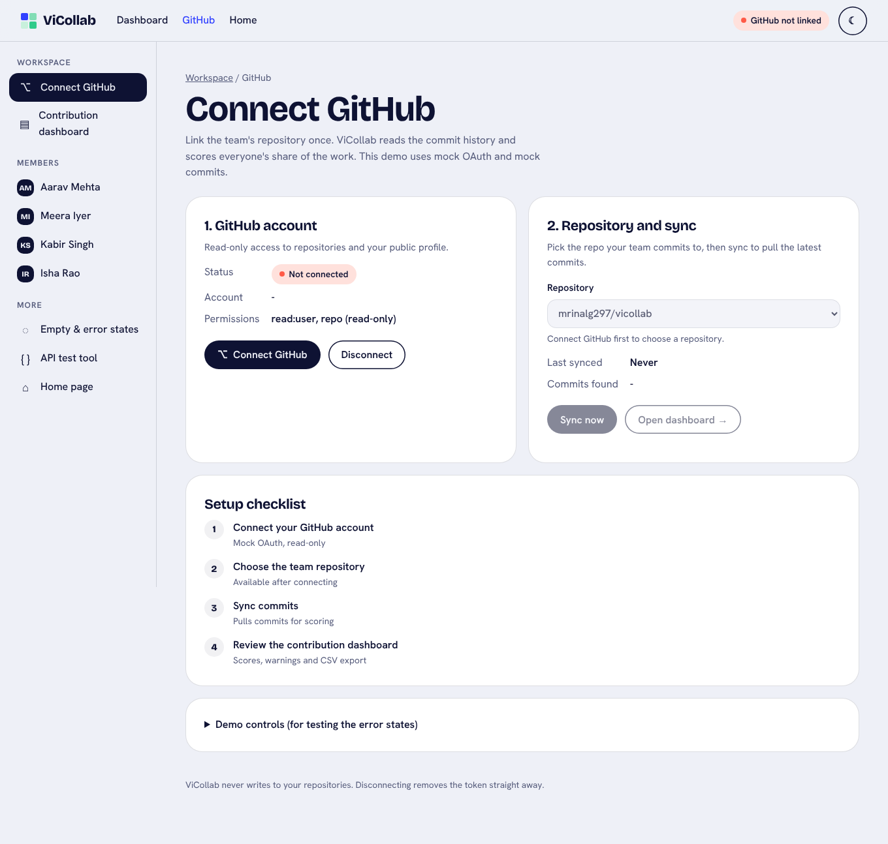

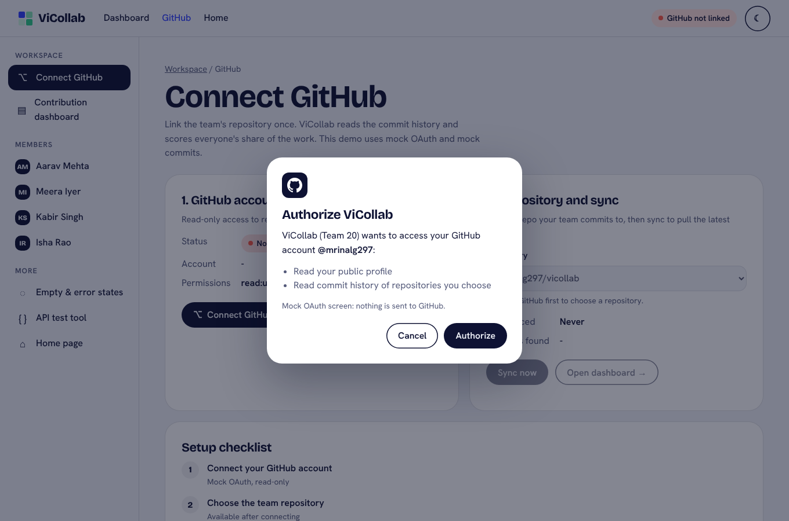

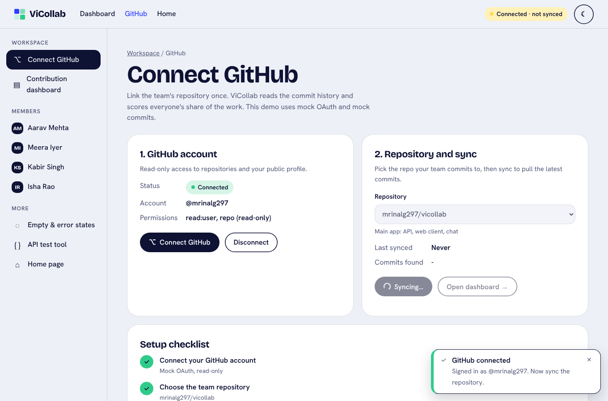

### Screen 2: Contribution Dashboard (`app/dashboard.html`)

| Element | Type | Purpose |
|---|---|---|
| **From / To** | Date inputs | Start and end of the date range. Every change calls the scoring API again. |
| **Quick ranges** | Chip buttons (toggle) | All 12 weeks, Last 4 weeks, Sprint 1 (weeks 1–2). The active chip is shown as pressed. |
| **Find a member** | Search input | Filters the chart and the table live. Shows "Showing 2 of 4 members". |
| **Export CSV** | Button | Downloads `vicollab-contributions_<from>_to_<to>.csv` and confirms with a toast |
| Summary cards | Output | Members, Commits scored, Lines changed, Not scored (merges, duplicates) |
| Dominance banner | Output | Yellow ⚠ "One member dominates this range", with a **View Kabir** button |
| Zero-commit banner | Output | ⓘ "No commits in this range: Kabir Singh …" |
| Score chart | Output (chart) | One horizontal bar per member with the value at the tip and a line at the 60% limit. Bars above the limit turn yellow and get ⚠. Hover or focus shows a tooltip with commit and line shares. |
| Members table | Output (table) | Sortable columns (Member, Commits, Lines changed, Commit share, Lines share, Score) plus a Status badge (OK / Above 60% / No commits). Names link to Screen 3. |

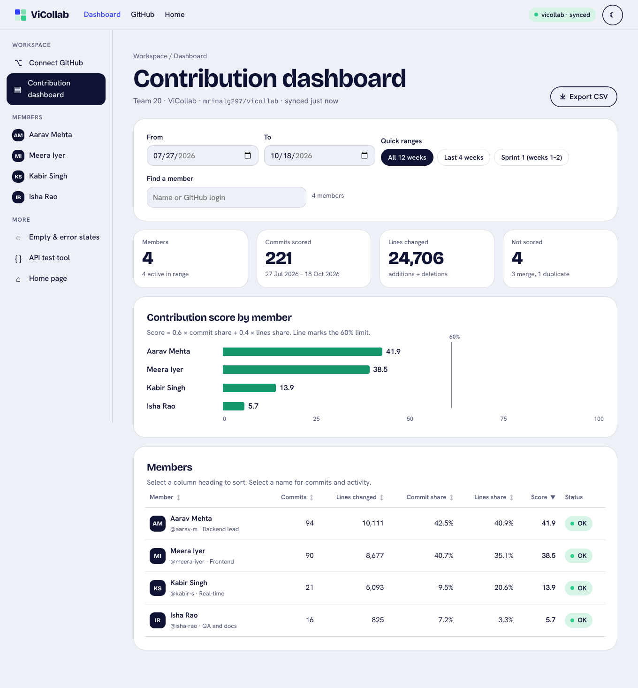

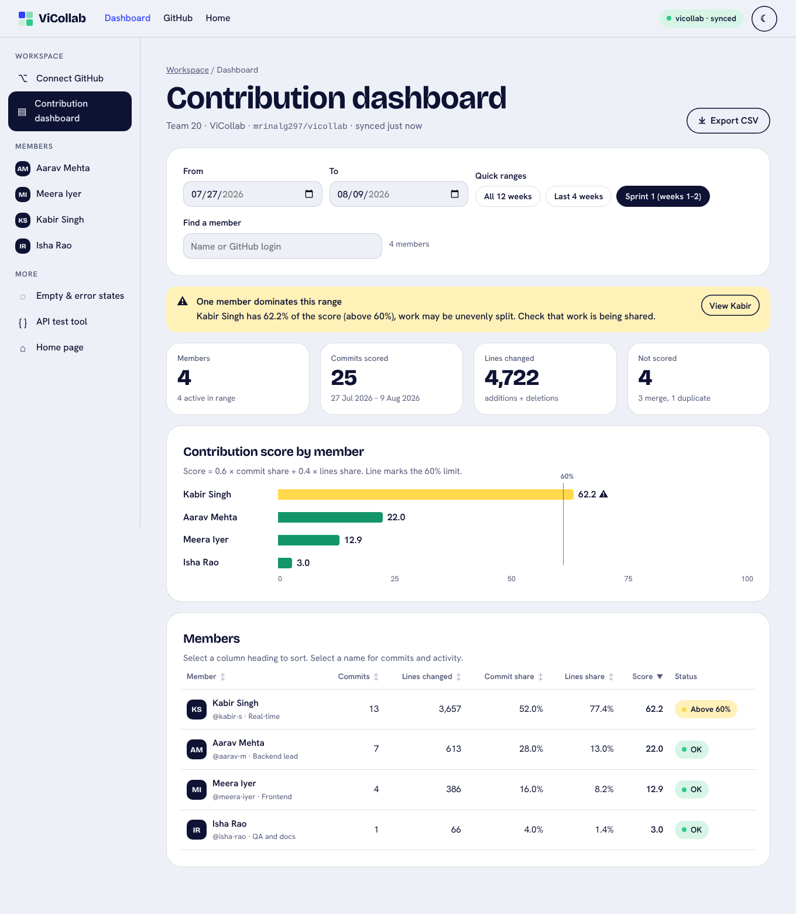

### Screen 3: Member Detail (`app/member.html?m=<login>`)

| Element | Type | Purpose |
|---|---|---|
| Header | Output | Avatar, name, `@login`, role, **last active** date, an "Inactive N weeks" badge after 14 days without commits, and **skill tags** |
| **Switch member** | Select | Jump to another member without going back |
| From / To + Quick ranges | Inputs | The same range widget as the dashboard. The range is carried between the two screens. |
| Stat cards | Output | Score in range, Commits, Lines added (+), Lines deleted (−) |
| Commits over time | Output (chart) | Columns per week across 12 weeks. Weeks outside the range are faded. Each column has a hover or focus tooltip, plus **View as table**. |
| Lines added vs deleted | Output (chart) | Split bar with a legend and values, plus average and largest commit |
| Commit list | Output | Short sha, message, time, +/− lines, newest first. Merge commits are tagged "merge · not scored". **Show all N commits** keeps keyboard focus in place. |

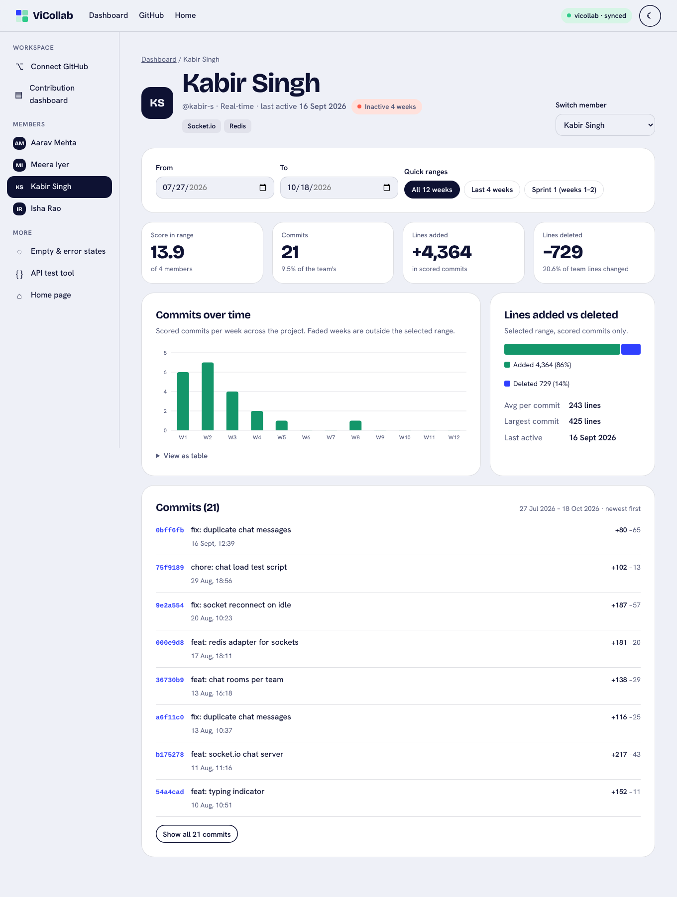

### Screen 4: Empty and error states (`app/states.html`, and live on screens 1–3)

All four use the same block: an icon, a plain-language title and reason, then a primary recovery button (and sometimes a second one). The gallery page shows them side by side, and **Try it live** puts the app into that state.

| State | When it appears | Recovery button(s) |
|---|---|---|
| GitHub not linked | Dashboard or member page before connecting | **Connect GitHub** |
| No commits in range | Nobody committed in the chosen dates (e.g. 19–25 Oct) | **Show all 12 weeks** |
| Sync failed | GitHub returned an error (mock 503) | **Retry sync**, GitHub settings. If older data exists, the dashboard keeps it and shows a red "latest sync failed" banner with Retry. |
| Invalid date range | "From" is after "To". The page catches this before calling the API, and the inputs are marked `aria-invalid`. | **Reset to all 12 weeks** |

Extra states handled in the same style: a synced repository with no commits (*Change repository*), a member with no commits in range, an unknown member link, and the scoring service being unreachable (*Try again*).

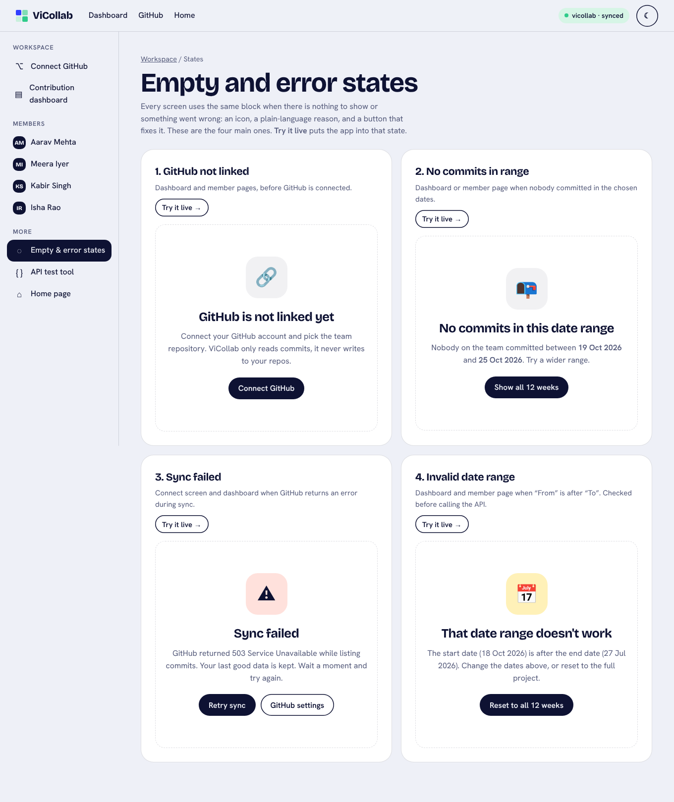

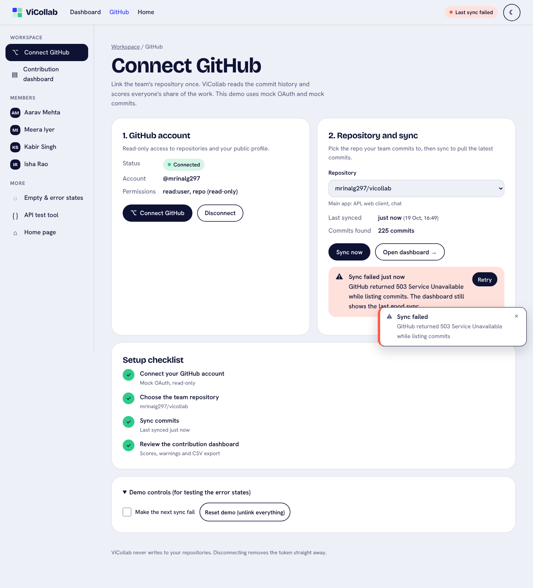

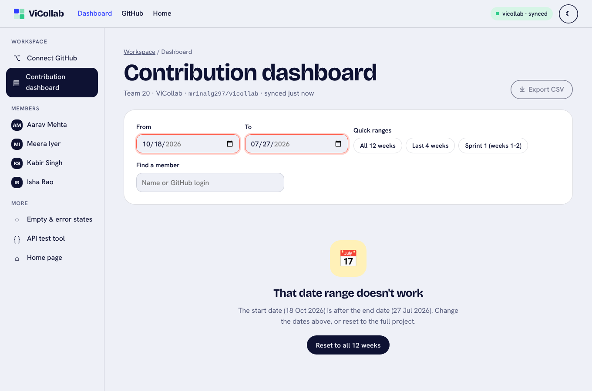

### Responsive and dark mode

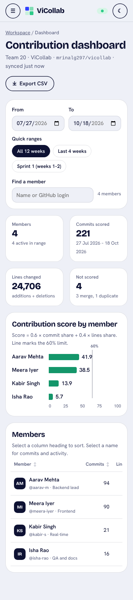

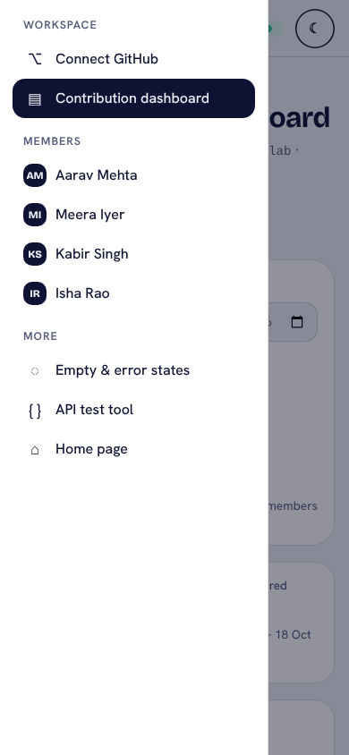

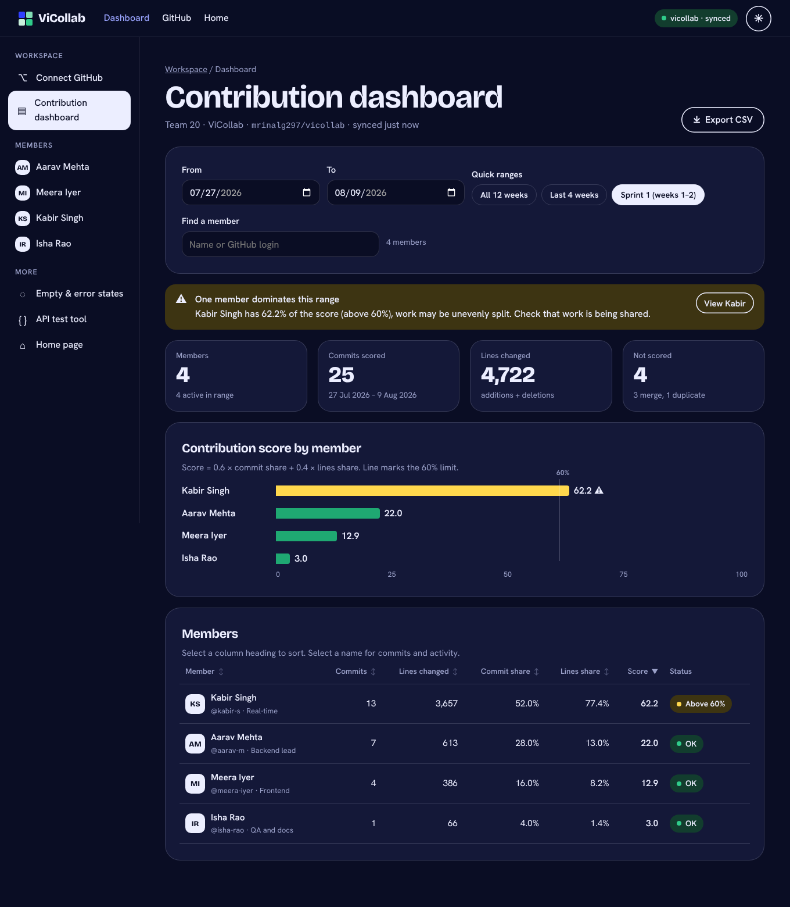

## 4. Design principles followed

### 4.1 Simplicity
* **One job per screen:** connect on Screen 1, compare members on Screen 2, look closely at one person on Screen 3.
* **Progressive disclosure:** the commit list shows 8 commits, with *Show all*. Chart data is behind *View as table*. Demo controls sit in a closed `<details>`.
* **Plain language:** "Not scored: 3 merge, 1 duplicate" instead of API field names, and people's names instead of GitHub logins in the warnings.
* **Few, strong colours:** mint for normal bars, yellow only for "above 60%", red only for errors. The formula is printed under the chart, so nobody has to guess what a score means.

### 4.2 Consistency
* **Same tokens as the home page:** cobalt, mint, yellow and ink colours; Bricolage Grotesque headings and Hanken Grotesk text; pill buttons; 26 px rounded cards.
* **One shell** is written once in `app.js` and used by every screen: the same top nav, sidebar, badge, theme toggle, toast area and skip link.
* **Repeated components:** one date-range widget on the dashboard and member pages, one empty/error state block for every state, one badge style (OK / Above 60% / No commits / Connected) everywhere.
* **Same placement:** page title and breadcrumb at the top left, primary page action at the top right (Export CSV), filters above results.

### 4.3 Usability
* **Recognition over recall:** quick-range chips, a member switcher, the breadcrumb, and an `aria-current` highlight on the current page in both menus.
* **Error prevention:** the repository menu is disabled until GitHub is linked, and the date range is checked before the API call. The form explains *why* something is disabled.
* **Shared state:** the date range follows you from the dashboard to a member and back (URL and session), so links can be bookmarked or shared.
* **Accessible by default:**
  * a skip link, landmarks, labels on every input, and sortable headers as real buttons with `aria-sort`
  * chart bars and columns that can be reached with Tab and have text labels
  * a table alternative for the time chart
  * `role="alert"` on errors
  * an Esc-closable drawer that moves focus into itself
  * 44 px main buttons and inputs (36 px for small buttons and chips)
  * reduced-motion and forced-colors support
* **Responsive:** the 4 stat cards drop to 2 columns, the sidebar becomes a drawer, the table scrolls inside its card, and the time chart redraws at its real width so labels stay readable.

### 4.4 Feedback
| User action | Feedback |
|---|---|
| Connect → Authorize | Spinner and "Connecting…", then a toast "GitHub connected, signed in as @mrinalg297", the badge turns green, and focus moves to **Sync now** |
| Sync now | The button changes to a spinner and "Syncing…" and is disabled. Then a toast "Sync complete, 225 commits…" or an error toast plus a red banner with **Retry**. |
| Change dates or a chip | "Updating scores…" spinner, results fade while loading, the chip shows as pressed |
| Bad dates | Red outline on both inputs and the invalid-range state with a reset button |
| Search | "Showing 2 of 4 members" (announced by screen readers), or "No members match … Clear search" |
| Sort | The ▲ / ▼ arrow plus `aria-sort` |
| Export CSV | The file downloads and a toast shows "4 members, 27 Jul – 18 Oct" |
| Always visible | The top-nav badge: *Not linked* / *Connected · not synced* / *vicollab · synced* / *Last sync failed* |

## 5. How the interface supports interaction and meets the requirements

| Req. | UI that satisfies it | Checked by |
|---|---|---|
| FR-1 | Connect GitHub button → OAuth dialog → status badge. Disconnect button. | Walkthrough steps 2–3: toast "GitHub connected", badge "Connected · not synced" |
| FR-2 | Repository select on Screen 1 | Walkthrough: switching to `sandbox` gives the "This repository has no commits" state |
| FR-3 | Sync now (spinner) and Last synced | Walkthrough: button disabled with "Syncing…", then "just now", "225 commits" |
| FR-4 | Summary cards | Walkthrough: 4 members, 221 commits scored, 24,706 lines, 4 not scored |
| FR-5 | Score bar chart and member table, values from `POST /api/contributions/score` | Values match the API and `scoreContributions` (Aarav 41.9, Meera 38.5, Kabir 13.9, Isha 5.7) |
| FR-6 | From/To inputs and quick-range chips, sent as `since`/`until` | Sprint 1 → 25 commits, Kabir 62.2. Last 4 weeks → Kabir 0. |
| FR-7 | Sortable headers and the search box | Sort by commits desc/asc reorders rows; "me" shows 2 of 4; "zzz" shows the empty message |
| FR-8 | Export CSV | A downloaded file with a header row and 4 member rows (see §6) |
| FR-9 | Yellow dominance banner, yellow bar with ⚠, "Above 60%" badge; zero-commit info banner and "No commits" badge | Sprint 1 banner: "Kabir Singh has 62.2% of the score (above 60%)…" |
| FR-10 | Screen 3: commit list, weekly chart, added/deleted split, last active, tags | Kabir: last active 16 Sept 2026, "Inactive 4 weeks", +4,364 / −729 lines |
| FR-11 | Four standard states with recovery buttons | Walkthrough steps 11 and the states gallery: each one appears and its button recovers |
| NFR-1 | Tokens and fonts copied from the home page | Screenshots |
| NFR-2 | Shared `shell()` in `app.js` | Same nav and sidebar on all screens |
| NFR-3 | Responsive CSS | No sideways page scroll at 390 px on the dashboard, member and connect pages |
| NFR-4 | Keyboard support | First Tab goes to "Skip to content"; Enter moves focus to `main`; drawer opens with focus inside and closes with Esc |
| NFR-5 | Contrast-checked tokens and a separate dark palette | **axe-core: 0 violations on all 6 views in both light and dark mode** (`docs/test-output/ui-a11y-axe.txt`) |
| NFR-6 | Spinners, toasts, banners, live regions | Walkthrough log |

**Typical task: a team lead checking Sprint 1.**
1. In the sidebar, click **Contribution dashboard**.
2. Click the **Sprint 1** chip. The scores update, and a yellow banner says Kabir has 62.2%.
3. Click **View Kabir**. The member page opens with the same range, showing his commits, a busy week 1–2 and the "Inactive 4 weeks" badge.
4. Click **Dashboard** in the breadcrumb, then **Export CSV** for the review meeting.

That's four clicks, with no typing and nothing to remember.

## 6. Evidence that it works

* **Scripted walkthrough** (`scripts/ui-design-walkthrough.js`, log in `docs/test-output/ui-design-walkthrough.txt`) drives every flow in Chromium and captured all the screenshots in `docs/ui-screens/`. The browser console showed **no errors**.
* **Exported CSV** (real file from the walkthrough):

```
Member,GitHub login,Role,Commits,Lines changed,Commit share %,Lines share %,Score,From,To
Aarav Mehta,aarav-m,Backend lead,94,10111,42.5,40.9,41.9,2026-07-27,2026-10-18
Meera Iyer,meera-iyer,Frontend,90,8677,40.7,35.1,38.5,2026-07-27,2026-10-18
Kabir Singh,kabir-s,Real-time,21,5093,9.5,20.6,13.9,2026-07-27,2026-10-18
Isha Rao,isha-rao,QA and docs,16,825,7.2,3.3,5.7,2026-07-27,2026-10-18
```

* **Accessibility:** axe-core 4.10 (WCAG 2.1 A/AA and best-practice rules) on Connect, Dashboard (all-time, Sprint 1, invalid range), Member and States, in light and dark mode: **0 violations**. The first audit found 5 kinds of issue and we fixed them all:
  * the 60% label's contrast
  * a duplicate landmark label
  * chart hit-areas missing a role
  * "+lines" text drawn in the chart colour
  * dark-mode blue links at 4.43:1, fixed with a separate lighter `--link` colour
* **Charts:** the 2-colour palette (mint and blue) was checked with a colour-vision validator in both modes. Dark mode needed a darker mint (`#1FA872`) to pass. Bars and columns have text labels, a tooltip and a table alternative, so colour is never the only cue.
* **Automated tests:** `npm test` runs 64 tests, all passing: the original 51 API and scoring tests plus 13 new UI tests (pages served with the shared shell, and the mock data producing the dominance, zero-commit, empty-repo and bad-range states). Coverage of `src/` stays at 100%. `scoring.js` and `app.js` were not changed.

## 7. Files

| File | Purpose |
|---|---|
| `public/app/app.css` | Shared styles and tokens (light and dark) |
| `public/app/app.js` | Shared shell (nav, sidebar, drawer, theme), toasts, state, mock OAuth and sync, API call, range widget, charts, empty states, CSV |
| `public/app/mock-data.js` | Seeded mock team (4 members), 3 repositories, 225 commits over 12 weeks |
| `public/app/connect.html` | Screen 1 |
| `public/app/dashboard.html` | Screen 2 |
| `public/app/member.html` | Screen 3 |
| `public/app/states.html` | Screen 4 gallery |
| `tests/ui.test.js` | UI and mock-data tests |
| `scripts/ui-design-walkthrough.js`, `scripts/ui-a11y-audit.js` | Walkthrough and accessibility audit |

**Run:** `npm install`, then `npm start`, then open `http://localhost:3000/app/`. Start on **Connect GitHub**, then Authorize, then Sync now.
